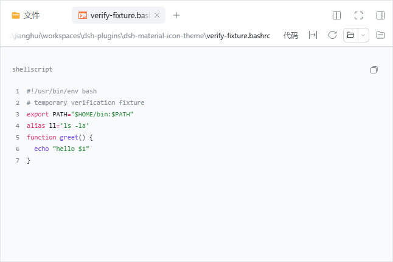

# @jianghuifr/dsh-highlight

[](https://github.com/jianghuifr/dsh-highlight/actions/workflows/ci.yml)
[](https://www.npmjs.com/package/@jianghuifr/dsh-highlight)

为 DeepSeek Harness Web UI 的 dotfile 提供带行号、语法着色的代码预览。官方预览对 `.bashrc`、`.zshrc`、`.gitconfig` 这类 dotfile 只显示纯文本，本插件认领 47 个常见后缀；能识别语法的格式会上色（shell、ini、yaml、json、python、perl、ruby、javascript），其余保留行号与复制。



## 安装

```bash
plugin_manager install_bundle target=@jianghuifr/dsh-highlight
```

也可以用本地目录：`plugin_manager install_bundle target=<本目录绝对路径>`。

安装后在 **Plugins → 本插件详情 → Components → `dotfile 代码高亮 ›`** 打开配置：


- `dotfile 语法高亮`（默认开）。
- 关闭后这些文件回到官方纯文本预览。
- 设置保存在浏览器 localStorage，刷新后保持。

## 许可

MIT。
